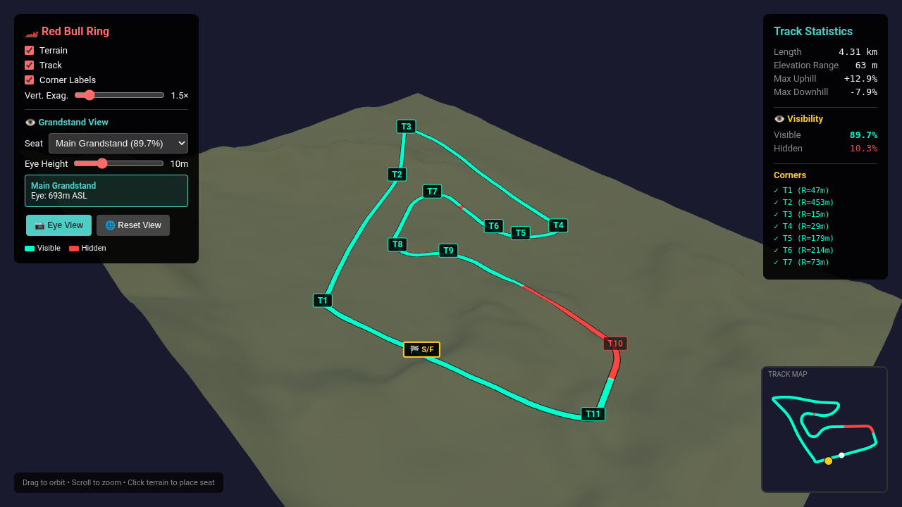
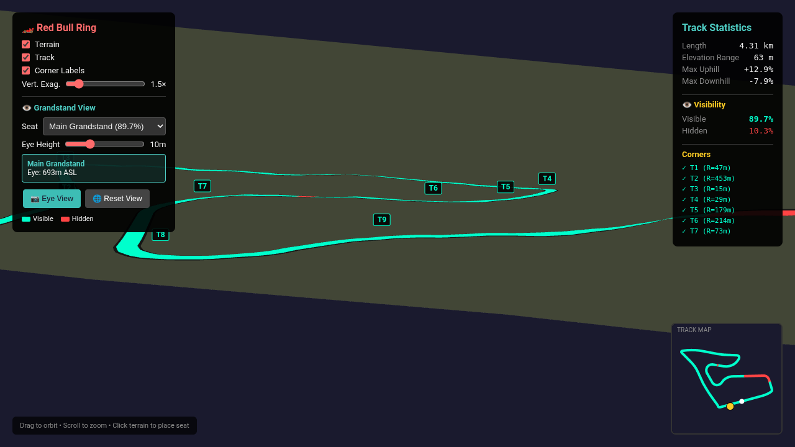
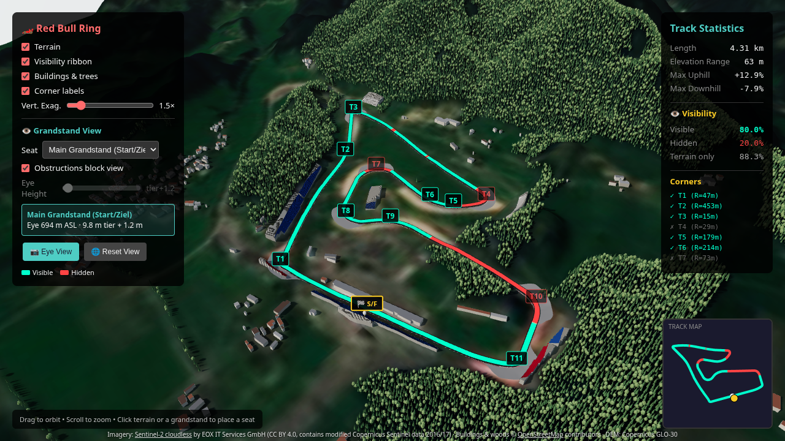
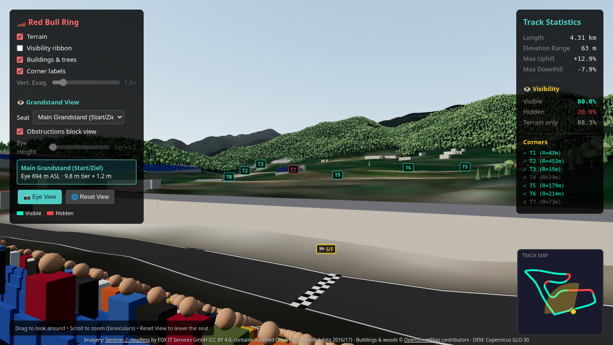
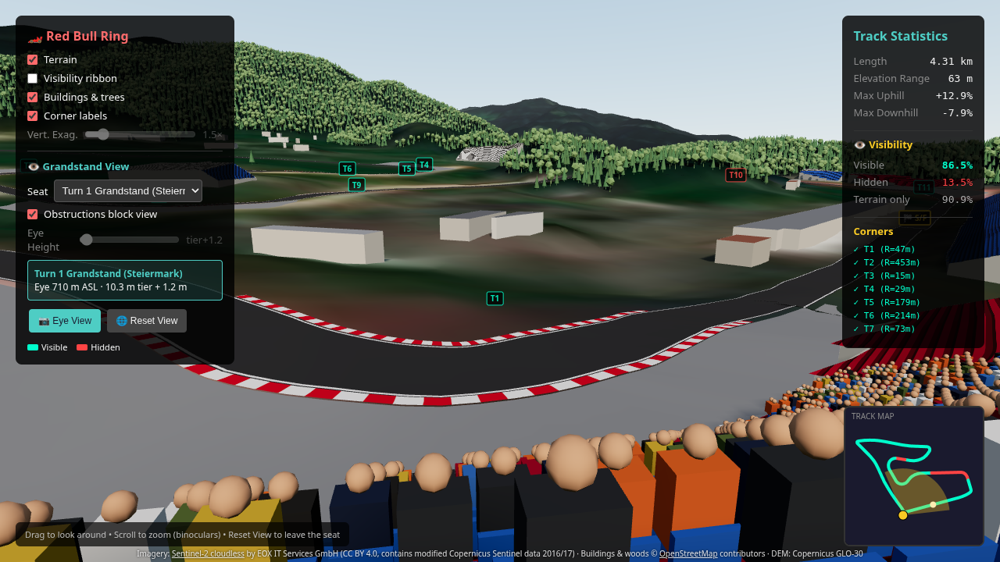
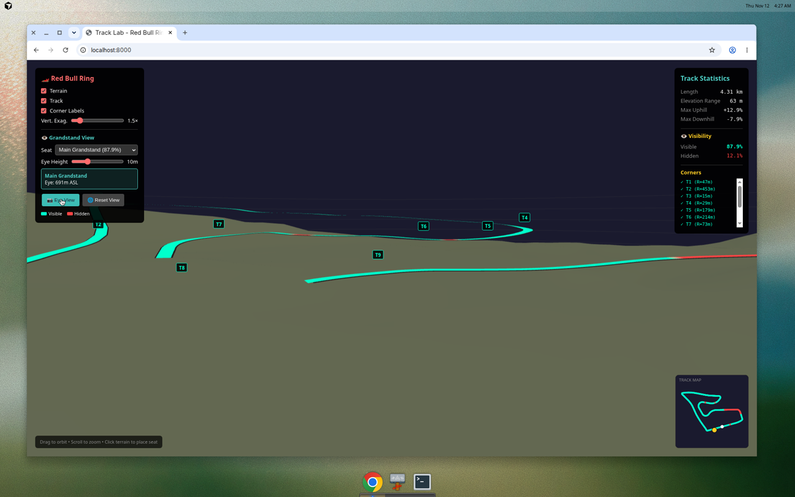

# track-lab

AI-collaborative race-track design lab (exploration)

## Spike 3: A real seat, with real obstructions

Spike 2 measured line of sight over bare terrain, so every seat looked like an
empty hillside and the main grandstand "saw" ~90% of the lap. Spike 3 adds what
actually blocks a spectator's view, and makes the seat view look like the place.

| | Overview | Main grandstand eye view |
|---|:---:|:---:|
| Before |  |  |
| After |  |  |

Turn 1 (Steiermark Tribüne) eye view: 

### Surface model (used by both the Python and the browser viewshed)

`scripts/surface_model.py` builds a 5 m obstruction raster on top of the DEM from
the committed OSM fixture `data/obstructions/red_bull_ring_osm.geojson`:

| Layer | Source (OSM) | Height |
|---|---|---|
| Buildings (438) | `building=*` | `height`, else `building:levels` × 3 m, else 8 m |
| Grandstands (9) | `building=grandstand` | stand height (`height`/levels, else 12 m); seating deck rises from 2 m at the edge nearest the track at ≥ 0.45 m/m (~24°), then flat |
| Woodland (210 ha) | `landuse=forest`, `natural=wood`, `natural=tree_row` (6 m wide), `natural=tree` (r 4 m) | canopy 15 m |

The track corridor (12 m either side of the centreline) is always clear, and a
seat is never blocked by the stand it sits in (the rake that lets you see over
the rows in front is finer than a 5 m raster). Grandstand presets are generated
from the OSM stands: seat in the top row of the deck, mid-stand, **eye 1.2 m
above the tier**. With obstructions switched off the same eye height is used,
so the difference is purely what the obstructions block.

Line of sight: 256 samples per ray in both Python and JS
(`viewer/viewshed.js` is a line-for-line port of the Python sampler); target
1.0 m above the road; bilinear DEM + nearest-cell obstruction height.

### Visible % with obstructions

Viewer numbers (full Copernicus tile, `make viewer-data`):

| Preset (OSM grandstand) | Terrain only | With obstructions |
|---|---:|---:|
| **Main Grandstand (Start/Ziel Tribüne)** | 88.3% | **80.0%** |
| Turn 1 Grandstand (Steiermark Tribüne) | 90.9% | 86.5% |
| Red Bull Tribüne | 91.1% | 74.3% |
| Red Bull Tribüne #2 | 89.3% | 69.2% |
| Tribüne Mitte | 79.5% | 71.1% |
| Tribüne Nord | 70.6% | 58.2% |
| Tribüne 13 | 72.7% | 41.9% |
| Tribüne T10 | 35.9% | 26.8% |
| Tribüne Ost | 38.9% | 19.1% |

`make verify` runs offline on the committed 30 KB DEM crop, which is resampled
slightly differently from the full tile, so its numbers differ (main grandstand
86.5% → 69.9%). It checks that obstructions lower the main grandstand's score,
that a paddock spot behind the pit building (31.5% → 21.9%) and a spot in the
woods above Turn 3 (84.6% → 0.0%) lose visibility, that rebuilding the surface
model gives identical results, and that the JS viewer agrees with Python on all
nine presets (within 2 pp; currently identical). The parity check needs
`node` (18+); set `SKIP_JS_PARITY=1` to skip it.

Caveat: Copernicus GLO-30 is itself a surface model at 30 m, so it already
contains some of the canopy and large roofs; adding OSM heights on top errs
towards blocking more.

### Viewer

- Terrain draped with a baked **Sentinel-2 cloudless** texture (3 m/px, 270 KB, committed)
- Extruded OSM buildings, raked grandstands with seat-row stripes, ~26k instanced low-poly trees
- Three.js `Sky`, sun with soft shadows (static shadow map, re-rendered only when the view changes), ACES tone mapping, distance haze
- Road surface at true elevation with edge lines, red/white kerbs at corners, grey run-off outside the tight corners
- Overview keeps the colour-coded visibility ribbon, corner labels and minimap; a checkbox toggles whether obstructions count
- **Eye view**: 1 s animated flight into the seat, vertical exaggeration flattens to 1×, 60° vertical FOV, initial look at the centroid of the visible track; drag to look around, scroll to zoom (binoculars); seat rows and a seated crowd around you on grandstand seats
- Click a grandstand to sit in it (eye = tier + 1.2 m) or the ground to stand (eye-height slider); custom seats are computed in the browser with the same algorithm
- URL parameters for sharing/screenshots: `?seat=turn1_grandstand&view=eye&yaw=-25&pitch=-12`

Viewer data for the crop is ~1.9 MB in total (budget 15 MB).

### Refreshing the fixtures (network, optional)

```bash
make fetch-obstructions   # Overpass mirrors with retries, falls back to the OSM API
make fetch-imagery        # EOX Sentinel-2 cloudless WMTS tiles -> baked JPEG
make viewer-data && make serve
make screenshots          # with `make serve` running; uses headless Chrome
```

### Data attribution (Spike 3 additions)

| Data | Source | License |
|---|---|---|
| Buildings, grandstands, woodland | © [OpenStreetMap](https://www.openstreetmap.org/copyright) contributors (via Overpass, fetched 2026-11-12) | ODbL 1.0 |
| Imagery | [Sentinel-2 cloudless](https://s2maps.eu) by EOX IT Services GmbH (contains modified Copernicus Sentinel data 2016 & 2017) | CC BY 4.0 |

The 2016 s2cloudless layer is used because it is CC BY 4.0 (attribution
only); the later yearly layers are CC BY-NC-SA 4.0.

---

## Spike 2: Grandstand View Analysis

Building on Spike 1, this spike answers: **can the "arena" feeling of a circuit be turned into a number?**

The Red Bull Ring is known for its excellent spectator sightlines—you can see much of the lap from any grandstand thanks to the natural bowl-shaped terrain. This spike quantifies that by computing line-of-sight visibility from any seat position over the DEM.

| Default View | Eye View |
|:---:|:---:|
|  |  |

### Key Features

- **Track Ribbon**: 14m wide ribbon draped on terrain with dark outline for contrast
- **Visibility Highlighting**: Bright cyan for visible sections, red for hidden
- **Corner Labels**: Numbered T1–T11 labels plus checkered start/finish line
- **2D Minimap**: Bottom-right inset showing full lap with visibility coloring
- **Eye View Camera**: Animated transition to spectator perspective
- **Terrain Focus**: Camera framed on track; terrain cropped to ~400m margin
- **CLI Viewshed**: `make viewshed SEAT=lat,lon` computes visibility from command line

### Visibility Results (Spike 2: bare terrain, original seat positions, eye 10 m above ground)

| Position | Visible % | Sees Start/Finish | Visible Corners |
|----------|-----------|-------------------|-----------------|
| Main Grandstand | 87.9% | ✓ Yes | 10/11 |
| Turn 1 Grandstand | 90.4% | ✓ Yes | 10/11 |
| NE Corner (poor) | 5.6% | ✗ No | 1/11 |
| North Hills | 82.1% | ✓ Yes | 10/11 |

The main grandstand at the Red Bull Ring can see **88% of the track** including the start/finish straight and 10 of 11 corners—confirming the "arena" reputation is real and measurable.

### Viewshed CLI

```bash
# Compute visibility from main grandstand
make viewshed SEAT=main_grandstand

# Compute visibility from custom coordinates
make viewshed SEAT=47.2194,14.7630

# List available preset seats
make viewshed
```

---

## Spike 1: Terrain + Centreline

This spike fetches real elevation data for the **Red Bull Ring** (Spielberg, Austria) and drapes the circuit centreline over it, displaying both in an interactive 3D viewer.

### Quick Start

```bash
# 1. Install dependencies
make setup

# 2. Fetch DEM + analyze + export viewer data
make all

# 3. View in browser
make serve
# Open http://localhost:8000
```

That's it! The viewer shows the track in its valley with orbit/zoom controls and adjustable vertical exaggeration.

### What's Included

- **Centreline GeoJSON** (`data/centrelines/red_bull_ring.geojson`) — editable track centerline
- **3D Viewer** — Three.js terrain mesh with draped track, corner markers, and stats panel
- **CLI Analysis** — `make stats` prints length, elevation, gradients, corner radii
- **Verification** — `make verify` runs offline tests against official circuit data

### Data Sources & Attribution

| Data | Source | License |
|------|--------|---------|
| Elevation | [Copernicus DEM GLO-30](https://spacedata.copernicus.eu/collections/copernicus-digital-elevation-model) via [AWS Open Data](https://registry.opendata.aws/copernicus-dem/) | Free & open (Copernicus) |
| Centreline | [bacinger/f1-circuits](https://github.com/bacinger/f1-circuits) | MIT |
| Original geometry | [OpenStreetMap](https://www.openstreetmap.org) | ODbL |

**No accounts, API keys, or payments required** — all data is freely downloadable from public sources.

### Swapping in a Different Centreline

1. Create a GeoJSON file with a `LineString` geometry in `[longitude, latitude]` order (WGS84)
2. Save it to `data/centrelines/your_track.geojson`
3. Run:
   ```bash
   python3 scripts/fetch_dem.py data/centrelines/your_track.geojson
   python3 scripts/analyze_track.py data/centrelines/your_track.geojson cache/dem/*.tif -o data/analysis.json
   python3 scripts/export_viewer_data.py --analysis data/analysis.json --dem cache/dem/*.tif --output-dir viewer/data
   make serve
   ```

### Calibration: Red Bull Ring

Computed values vs official circuit data from the [FIA Media Kit (2026 Austrian GP)](https://www.fia.com/sites/default/files/media_kit_-_2026_austrian_grand_prix.pdf):

| Metric | Computed | Official | Diff |
|--------|----------|----------|------|
| Length | 4,306 m | 4,326 m | -20 m (0.5%) |
| Elevation change | 63 m | 65 m | -2 m |
| Max uphill gradient | 12.6% | 12% | +0.6% |
| Max downhill gradient | 7.7% | 9.3% | -1.6% |
| Base altitude | 678 m | 677 m | +1 m |

**Why the differences?**
- **Length (20m / 0.5% short):** OSM centreline follows approximate track center, not the FIA racing line. The FIA notes: "The center line is used for the measurement, rather than the ideal racing line."
- **Gradients:** Computed from DEM with 100m rolling window. Max uphill (12.6%) matches published 12% closely. Max downhill (7.7%) is lower than published 9.3%, likely due to centreline smoothing or DEM resolution.
- **Elevation:** 63m range vs official 65m — within DEM vertical accuracy (~1-2m).

### How Noise is Handled

1. **Elevation smoothing:** Gaussian filter (σ=3 points) on sampled DEM values removes single-point spikes
2. **Gradient window:** 100m rolling window for slope calculation prevents spurious peaks from DEM pixelation
3. **Curvature smoothing:** Path coordinates are Gaussian-filtered before curvature computation
4. **Point interpolation:** Original 81-point centreline interpolated to ~430 points (~10m spacing) for stable curvature

### Make Targets

```
make setup       # Install Python dependencies
make fetch-dem   # Download DEM tiles (~40 MB)
make analyze     # Analyze track profile
make viewer-data # Export data for 3D viewer
make serve       # Start local server at http://localhost:8000
make stats       # Print track statistics (CLI)
make viewshed    # Compute viewshed (usage: make viewshed SEAT=lat,lon)
make verify      # Run offline verification tests (uses committed fixture)
make clean       # Remove generated files (keeps cache)
```

### Directory Structure

```
track-lab/
├── data/
│   ├── centrelines/      # GeoJSON track centerlines (committed)
│   ├── fixtures/         # Test fixture DEM crop (committed, ~30KB)
│   ├── obstructions/     # OSM buildings/grandstands/woods fixture (committed, ~170KB)
│   ├── imagery/          # Baked Sentinel-2 cloudless texture (committed, ~270KB)
│   └── analysis.json     # Generated analysis output
├── cache/                # Downloaded DEM tiles (gitignored)
├── docs/                 # Screenshots and documentation assets
├── viewer/
│   ├── index.html        # 3D viewer (Three.js)
│   ├── viewshed.js       # Browser line-of-sight (port of surface_model.py)
│   └── data/             # Generated terrain/track JSON (gitignored)
├── scripts/
│   ├── fetch_dem.py      # Download Copernicus DEM tiles
│   ├── analyze_track.py  # Compute track statistics
│   ├── compute_viewshed.py # Line-of-sight visibility calculation
│   ├── surface_model.py  # DEM + obstruction raster, shared LOS sampler
│   ├── fetch_obstructions.py # OSM buildings/grandstands/woods -> GeoJSON fixture
│   ├── fetch_imagery.py  # Bake Sentinel-2 cloudless texture
│   ├── js_viewshed.mjs   # Runs viewer/viewshed.js under Node for verify
│   ├── screenshot.sh     # Headless Chrome screenshots
│   ├── export_viewer_data.py
│   ├── serve.py          # Simple HTTP server
│   └── verify.py         # Offline verification tests
├── Makefile
└── requirements.txt
```

### Requirements

- Python 3.9+
- ~50 MB disk for DEM cache (one 1°×1° tile)
- Modern browser with WebGL for viewer

---

*Part of an exploration into AI-collaborative race-track design tools.*
