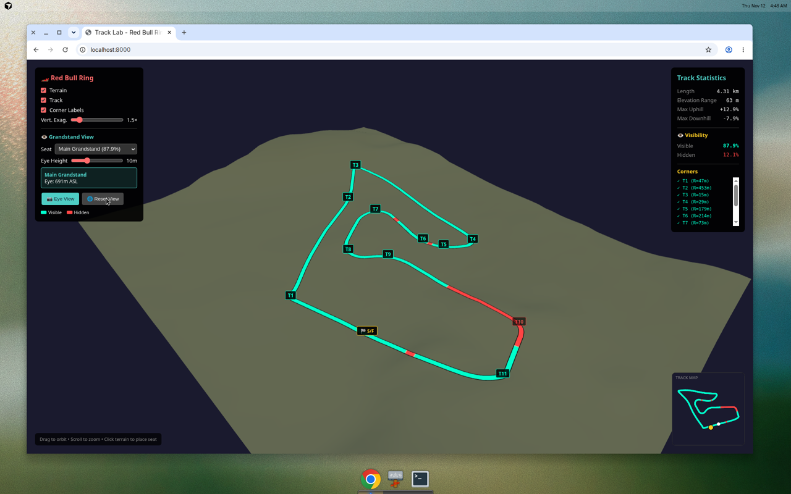

# track-lab

AI-collaborative race-track design lab (exploration)

## Spike 2: Grandstand View Analysis

Building on Spike 1, this spike answers: **can the "arena" feeling of a circuit be turned into a number?**

The Red Bull Ring is known for its excellent spectator sightlines—you can see much of the lap from any grandstand thanks to the natural bowl-shaped terrain. This spike quantifies that by computing line-of-sight visibility from any seat position over the DEM.

| Default View | Eye View |
|:---:|:---:|
|  |  |

### Key Features

- **Track Ribbon**: 14m wide ribbon draped on terrain with dark outline for contrast
- **Visibility Highlighting**: Bright cyan for visible sections, red for hidden
- **Corner Labels**: Numbered T1–T11 labels plus checkered start/finish line
- **2D Minimap**: Bottom-right inset showing full lap with visibility coloring
- **Eye View Camera**: Animated transition to spectator perspective
- **Terrain Focus**: Camera framed on track; terrain cropped to ~400m margin
- **CLI Viewshed**: `make viewshed SEAT=lat,lon` computes visibility from command line

### Visibility Results

| Position | Visible % | Sees Start/Finish | Visible Corners |
|----------|-----------|-------------------|-----------------|
| Main Grandstand | 87.9% | ✓ Yes | 10/11 |
| Turn 1 Grandstand | 90.4% | ✓ Yes | 10/11 |
| NE Corner (poor) | 5.6% | ✗ No | 1/11 |
| North Hills | 82.1% | ✓ Yes | 10/11 |

The main grandstand at the Red Bull Ring can see **88% of the track** including the start/finish straight and 10 of 11 corners—confirming the "arena" reputation is real and measurable.

### Viewshed CLI

```bash
# Compute visibility from main grandstand
make viewshed SEAT=main_grandstand

# Compute visibility from custom coordinates
make viewshed SEAT=47.2194,14.7630

# List available preset seats
make viewshed
```

---

## Spike 1: Terrain + Centreline

This spike fetches real elevation data for the **Red Bull Ring** (Spielberg, Austria) and drapes the circuit centreline over it, displaying both in an interactive 3D viewer.

### Quick Start

```bash
# 1. Install dependencies
make setup

# 2. Fetch DEM + analyze + export viewer data
make all

# 3. View in browser
make serve
# Open http://localhost:8000
```

That's it! The viewer shows the track in its valley with orbit/zoom controls and adjustable vertical exaggeration.

### What's Included

- **Centreline GeoJSON** (`data/centrelines/red_bull_ring.geojson`) — editable track centerline
- **3D Viewer** — Three.js terrain mesh with draped track, corner markers, and stats panel
- **CLI Analysis** — `make stats` prints length, elevation, gradients, corner radii
- **Verification** — `make verify` runs offline tests against official circuit data

### Data Sources & Attribution

| Data | Source | License |
|------|--------|---------|
| Elevation | [Copernicus DEM GLO-30](https://spacedata.copernicus.eu/collections/copernicus-digital-elevation-model) via [AWS Open Data](https://registry.opendata.aws/copernicus-dem/) | Free & open (Copernicus) |
| Centreline | [bacinger/f1-circuits](https://github.com/bacinger/f1-circuits) | MIT |
| Original geometry | [OpenStreetMap](https://www.openstreetmap.org) | ODbL |

**No accounts, API keys, or payments required** — all data is freely downloadable from public sources.

### Swapping in a Different Centreline

1. Create a GeoJSON file with a `LineString` geometry in `[longitude, latitude]` order (WGS84)
2. Save it to `data/centrelines/your_track.geojson`
3. Run:
   ```bash
   python3 scripts/fetch_dem.py data/centrelines/your_track.geojson
   python3 scripts/analyze_track.py data/centrelines/your_track.geojson cache/dem/*.tif -o data/analysis.json
   python3 scripts/export_viewer_data.py --analysis data/analysis.json --dem cache/dem/*.tif --output-dir viewer/data
   make serve
   ```

### Calibration: Red Bull Ring

Computed values vs official circuit data from the [FIA Media Kit (2026 Austrian GP)](https://www.fia.com/sites/default/files/media_kit_-_2026_austrian_grand_prix.pdf):

| Metric | Computed | Official | Diff |
|--------|----------|----------|------|
| Length | 4,306 m | 4,326 m | -20 m (0.5%) |
| Elevation change | 63 m | 65 m | -2 m |
| Max uphill gradient | 12.6% | 12% | +0.6% |
| Max downhill gradient | 7.7% | 9.3% | -1.6% |
| Base altitude | 678 m | 677 m | +1 m |

**Why the differences?**
- **Length (20m / 0.5% short):** OSM centreline follows approximate track center, not the FIA racing line. The FIA notes: "The center line is used for the measurement, rather than the ideal racing line."
- **Gradients:** Computed from DEM with 100m rolling window. Max uphill (12.6%) matches published 12% closely. Max downhill (7.7%) is lower than published 9.3%, likely due to centreline smoothing or DEM resolution.
- **Elevation:** 63m range vs official 65m — within DEM vertical accuracy (~1-2m).

### How Noise is Handled

1. **Elevation smoothing:** Gaussian filter (σ=3 points) on sampled DEM values removes single-point spikes
2. **Gradient window:** 100m rolling window for slope calculation prevents spurious peaks from DEM pixelation
3. **Curvature smoothing:** Path coordinates are Gaussian-filtered before curvature computation
4. **Point interpolation:** Original 81-point centreline interpolated to ~430 points (~10m spacing) for stable curvature

### Make Targets

```
make setup       # Install Python dependencies
make fetch-dem   # Download DEM tiles (~40 MB)
make analyze     # Analyze track profile
make viewer-data # Export data for 3D viewer
make serve       # Start local server at http://localhost:8000
make stats       # Print track statistics (CLI)
make viewshed    # Compute viewshed (usage: make viewshed SEAT=lat,lon)
make verify      # Run offline verification tests (uses committed fixture)
make clean       # Remove generated files (keeps cache)
```

### Directory Structure

```
track-lab/
├── data/
│   ├── centrelines/      # GeoJSON track centerlines (committed)
│   ├── fixtures/         # Test fixture DEM crop (committed, ~30KB)
│   └── analysis.json     # Generated analysis output
├── cache/                # Downloaded DEM tiles (gitignored)
├── docs/                 # Screenshots and documentation assets
├── viewer/
│   ├── index.html        # 3D viewer (Three.js)
│   └── data/             # Generated terrain/track JSON (gitignored)
├── scripts/
│   ├── fetch_dem.py      # Download Copernicus DEM tiles
│   ├── analyze_track.py  # Compute track statistics
│   ├── compute_viewshed.py # Line-of-sight visibility calculation
│   ├── export_viewer_data.py
│   ├── serve.py          # Simple HTTP server
│   └── verify.py         # Offline verification tests
├── Makefile
└── requirements.txt
```

### Requirements

- Python 3.9+
- ~50 MB disk for DEM cache (one 1°×1° tile)
- Modern browser with WebGL for viewer

---

*Part of an exploration into AI-collaborative race-track design tools.*
