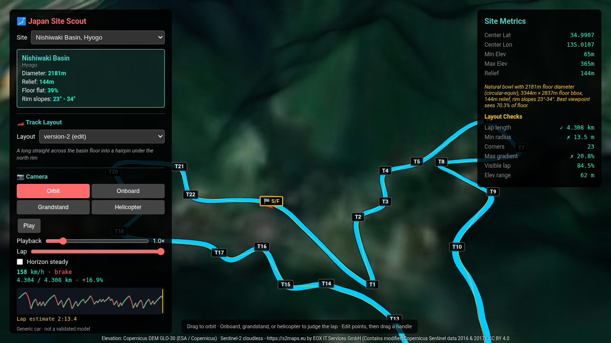

# Track Lab

An AI-collaborative race-track designer. Pick a real landscape, lay out a circuit from scratch, and check it as you go: gradients, corners, sightlines, a racing line, and a rough lap estimate.



## Why

I've been an F1 fan since I was about six. The tracks I love most are the classic ones that sit in the land, like Spielberg, where the valley itself forms an arena and one grandstand can see several sections of the lap. This project is me learning to design one.

## What's here

**Nishiwaki Basin** (Hyogo, Japan) is the design site: a natural bowl on real elevation data. You can load a starting layout, drag the control points, save a variant, and switch between orbit, onboard, grandstand, and helicopter views. A racing line and a quasi-static speed trace give a rough lap estimate (a generic car, not a validated model). A rule panel reports lap length, minimum radius, corner count, maximum gradient, and how much of the lap a rim viewpoint can see.

**Red Bull Ring** is the calibration site: the real Spielberg centreline draped on the same kind of terrain, with a grandstand viewshed that includes OSM buildings, stands, and trees.

Coming next, in open pull requests and not yet on `main`: a place-stand tool for saved grandstands, a designed vertical profile with limited cut and fill, run-off zones checked against the terrain, and a minimum-curvature racing line.

## How it was built

The work was done in small, one-job spikes with Cursor cloud agents. Each spike was reviewed (including Codex review threads, which were answered in the pull request) and previewed before merge.

## How to run

Python 3.10+, then:

```bash
make setup
```

To design on Nishiwaki Basin (site data is already in the repo):

```bash
python3 scripts/serve.py 8000
```

Open [http://localhost:8000/site.html?site=nishiwaki_basin&layout=version-1](http://localhost:8000/site.html?site=nishiwaki_basin&layout=version-1).

To view the Red Bull Ring (this downloads a Copernicus DEM tile on the first run, then writes `viewer/data/`):

```bash
make all
make serve
```

Open [http://localhost:8000](http://localhost:8000).

Offline checks:

```bash
make verify
make direction-loop-verify
```

`make verify` uses a committed DEM crop and does not need a network. The JavaScript parity check needs Node 18+; set `SKIP_JS_PARITY=1` to skip it.

## Credits and data

The code is released under the MIT License.

Committed elevation crops were produced using Copernicus WorldDEM-30 © DLR e.V. 2010-2014 and © Airbus Defence and Space GmbH 2014-2018 provided under COPERNICUS by the European Union and ESA; all rights reserved. The organisations in charge of the Copernicus programme by law or by delegation do not incur any liability for any use of the Copernicus WorldDEM-30. Source: [Copernicus DEM GLO-30](https://spacedata.copernicus.eu/collections/copernicus-digital-elevation-model) via [AWS Open Data](https://registry.opendata.aws/copernicus-dem/). Subsequent users of these elevation crops are bound by the same obligations.

Terrain imagery is [Sentinel-2 cloudless](https://s2maps.eu) by EOX IT Services GmbH (contains modified Copernicus Sentinel data 2016 & 2017), [CC BY 4.0](https://creativecommons.org/licenses/by/4.0/).

Buildings, grandstands, and woodland at the Red Bull Ring, and the original circuit geometry, are © [OpenStreetMap](https://www.openstreetmap.org/copyright) contributors, [ODbL 1.0](https://opendatacommons.org/licenses/odbl/). The Red Bull Ring centreline used here is from [bacinger/f1-circuits](https://github.com/bacinger/f1-circuits) (MIT).

No accounts, API keys, or paid services are required to run the project.
